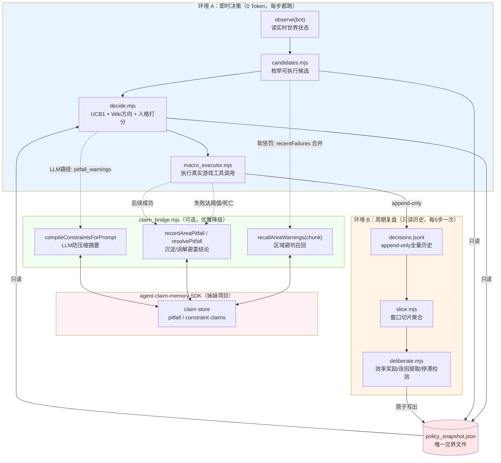

# brain/ —— 外挂式轨迹库 + A/B 物理隔离认知大脑

> 📖 架构与跨学科方法论总述：[`ARCHITECTURE_OVERVIEW.md`](./ARCHITECTURE_OVERVIEW.md)

[](../.github/workflows/brain-ci.yml)
[]()
[]()
[](../../agent-claim-memory)

> 面向读这个仓库的人：本目录在 **不改动上游 `minecraft-agent-harness` 一行 `src/` 源码**
> 的前提下，给它外挂一套可持久化、可跨 LLM 继承、**全程 0 Token 可复测**的决策大脑。
> 换一个模型、换一次对话、甚至完全不用 LLM，只要 `decisions.jsonl` / `policy_snapshot.json`
> 还在，经验就还在。
>
> **姊妹项目（双子星）**：本目录的"区域避坑记忆"和"LLM 陪玩防压缩提示"由零依赖
> SDK [`agent-claim-memory`](../../agent-claim-memory)（工作外置记忆裁决层，9/9 测试通过）
> 提供底座，通过 `brain/claim_bridge.mjs` 这一层薄胶水接入——**优雅降级**：如果你单独
> clone 本仓库、旁边没有 `agent-claim-memory` 目录，`claim_bridge.mjs` 会自动退化成
> 空实现，不装新依赖、不报错、不影响任何既有功能。两个项目各自独立开源、各自有自己的
> `node --test` 全绿覆盖，互相引用但互不污染。

## 1. 这是什么、解决什么问题

朴素的 LLM-驱动 Minecraft agent 每次开局都从零学起：上一局摸索出"这片森林要往东走才有树"
这种经验，下一局换个模型/新开一个对话就全部作废，而且每一步决策都要烧一次 LLM 调用。

`brain/` 把"决策"拆成物理隔离的两层：

- **环境 A（即时决策，0 Token）**：每一步只做一次 O(候选数) 的查表打分，绝不读历史日志，
  跑多快都行——这也是 `auto_loop.mjs` 能在完全不碰任何 LLM API 的情况下，让 bot 在真实
  服务器里持续做出决策的原因。
- **环境 B（周期复盘，只读历史）**：每攒够 5 条结果，把最近一段 `decisions.jsonl` 历史切片
  统计一遍（成功率、耗时效率、连招序列……），原子写出一份新的 `policy_snapshot.json`。

两层之间只通过一个文件交界，谁都不准越界：

```
┌───────────────────────────── 环境 A：即时决策（0 Token，每步都跑）──────────────────────────────┐
│                                                                                                   │
│   observe(bot) ──▶ candidates.mjs ──▶ decide.mjs ──▶ macro_executor.mjs ──▶ 真实游戏工具调用      │
│   (读实时世界状态)   (枚举可执行候选)   (UCB1+人格打分选一个)  (执行,含多步连招)                    │
│                        ▲                   ▲                                                      │
│                        │ 只读               │ 只读                                                 │
│                        └─────────┬─────────┘                                                      │
│                                  │                                                                 │
└──────────────────────────────────┼─────────────────────────────────────────────────────────────┘
                                   │
                        policy_snapshot.json   ◀── 唯一交界文件，policy_table.mjs 原子读写
                                   │            （深思熟虑后"一次性"整体替换，读者永远看到完整版本）
                                   ▲
┌──────────────────────────────────┼─────────────────────────────────────────────────────────────┐
│                                  │                                                                 │
│   decisions.jsonl ──▶ slice.mjs ──▶ deliberate.mjs ──┘                                             │
│   (append-only全量历史)(切片聚合)    (每5条结果触发一次：                                          │
│                                        效率奖励重算 / 连招提取 / 停滞检测 / HITL求助单)              │
│                                                                                                     │
│                        环境 B：周期复盘（只读历史，每 5 步跑一次，不直接操作游戏）                    │
└───────────────────────────────────────────────────────────────────────────────────────────────────┘
```

**硬隔离边界**（代码层面强制，单测里有专门断言）：
`recipe_planner.mjs` / `candidates.mjs` / `decide.mjs`（环境 A）绝不 `import` `stream.mjs`
或 `slice.mjs`，绝不直接读 `decisions.jsonl`。所有跨轮统计只能通过 `policy_snapshot.json`
（`policy_table.mjs` 原子读写）传递。

同样的 ASCII 图用 GitHub 原生 `mermaid` 再画一遍（含 `claim_bridge.mjs` 这层外挂记忆
如何在不打破上面那条硬隔离边界的前提下接进来——它只给环境 A 的调用方
（`auto_loop.mjs`/`tools_adapter.mjs`）提供一份"软惩罚建议"，`decide.mjs`/`candidates.mjs`
本身永远不知道、也永远不 `import` `claim_bridge.mjs`）：



## 2. 目录文件清单

| 文件 | 职责（一句话） |
|---|---|
| `stream.mjs` *(基础文件，不可改)* | 唯一写 `decisions.jsonl` 的地方，append-only。 |
| `slice.mjs` *(基础文件，不可改)* | 对 `decisions.jsonl` 做窗口切片/聚合统计，只读。 |
| `formulas.mjs` *(基础文件，不可改)* | 纯函数：UCB1 打分公式。 |
| `wiki.mjs` *(基础文件，不可改)* | 对照 `splits.json` 路线图，算出当前进度 `cur_idx`。 |
| `log.mjs` *(基础文件，不可改)* | 把"方向偏离/进度停滞"写成一条 `decisions.jsonl` 里的 deviation 记录。 |
| `splits.json` *(基础文件，不可改)* | 12 个里程碑路线图（木头→石头→铁→下界门）。 |
| `policy_table.mjs` | `policy_snapshot.json` 唯一的原子读写口——A/B 两层交界的物理闸门。 |
| `candidates.mjs` | 把世界观测拍扁成候选动作列表（含人格相关的 `isReserveGather` 分叉、地表感知的探索/放置目标）。 |
| `recipe_planner.mjs` | 纯配方推导：给定目标物品，递归算出下一步该采集/合成/放置/熔炼什么。 |
| `decide.mjs` | 环境 A 的打分器：UCB1 + Wiki 方向奖励 + 资格迹衰减 + 人格旋钮 + 连招惯性。 |
| `macro_executor.mjs` | 真正执行一个候选（含多步连招的逐步执行与坐标动态重算、超时productive-gather容错、dropsMissed假成功拦截）。 |
| `deliberate.mjs` | 环境 B 的复盘器：效率奖励重算、连招提取、停滞检测、HITL 求助单写入。 |
| `persona.json` | 3 套人格预设的纯配置（balanced / companion_builder / speedrunner）。 |
| `persona.mjs` | 纯读取 `persona.json`，带安全回退，不碰任何其它文件。 |
| `auto_loop.mjs` | **0-Token 实测入口**：直连真服务器，跑完整 观察→决策→执行→记录→复盘 闭环，不接 LLM。 |
| `run_win.mjs` | Windows 安全的 LLM 陪玩入口：接 DeepSeek/OpenAI 等模型，把 `brain_next_step`/`brain_record_outcome` 当工具塞给它。 |
| `tools_adapter.mjs` | `run_win.mjs` 用的 LLM 工具适配层：`brain_next_step`（环境A）/ `brain_record_outcome`（写环境B的数据源）。 |
| `status_report.mjs` | **只读中文体检看板**：一条命令看懂当前进度/偏好/连招/求助单/跨局成长轨迹。 |
| `wiki_priors.json` | Wiki 先验长链（木器/石器/铁器三条），仅在"真冷启动"（0 条历史）时注入 `stitched_macros`，本土宏跑出真实战绩后自然反超覆盖同 key 的先验。 |
| `multi_episode_eval.mjs` | **5 局离线确定性仿真**：0 LLM、0 真服依赖，驱动真实 `candidates`/`decide`/`deliberate` 管线，0.5 秒内打印第 1→5 局学习曲线。 |
| `claim_bridge.mjs` | **外挂区域避坑记忆 + LLM 防压缩摘要**：薄胶水层，接入姊妹项目 `agent-claim-memory`，旁侧目录缺失时优雅降级为空实现（见 §4(6)）。 |
| `brain.test.mjs` / `formulas.test.mjs` | `node --test` 单测，覆盖率含 A/B 隔离断言、先验冷启动、插槽/半路跳过、断点续跑、粒度对齐、局间复盘、物理结果对齐检查、`claim_bridge.mjs` 跨实例召回与优雅降级。 |
| `_archive/brain.mjs` | 已废弃的最早期原型（见下方"历史与归档"），未被任何模块引用。 |
| `双击查看MC大脑体检看板.bat` | **不懂命令行也能用**：双击运行 `status_report.mjs`，看完按任意键关闭。 |
| `双击跑5局跨局学习演示.bat` | **不懂命令行也能用**：双击运行 `multi_episode_eval.mjs`，1 秒看到 5 局学习曲线对比。 |

## 3. 5 分钟上手

> 以下命令均在仓库根目录 `minecraft-agent-harness/` 下执行。

### 3.1 跑单测（不需要服务器，不需要任何 API Key）

```bash
node --check brain/*.mjs           # 语法检查
node brain/brain.test.mjs          # 核心单测（含 A/B 隔离断言）
node brain/formulas.test.mjs       # UCB1 公式单测
```

单测结束后根目录 `decisions.jsonl` **保证与跑之前逐字节一致**（`brain.test.mjs` 的
`before()`/`after()` 钩子会自动备份还原，详见 §5）。

### 3.2 0-Token 实测（需要一台本地/局域网 Paper/Vanilla 服务器）

```bash
node brain/auto_loop.mjs --port 25565 --steps 15 --persona speedrunner
```

- 全程零 LLM 调用、零 API Key、零网络请求模型厂商；每一步都是纯查表+打分。
- `--persona <name>`：`balanced`（默认）/ `companion_builder`（陪伴囤货稳健型）/
  `speedrunner`（速通效率型）。也可用 `.env` 里的 `BRAIN_PERSONA=xxx` 设默认值，
  命令行 `--persona` 优先级更高。
- 跑完会在根目录生成/追加 `decisions.jsonl` 与 `policy_snapshot.json`
  ——**这两个文件不是源码，已被 `.gitignore` 排除**，重复运行、换人格、重开服务器都
  不会污染 git 状态。

### 3.2b 真机跨局长程实测：连续 3 局 × 每局 25 步（0 Token，诚实记录）

和 §3.5 的离线 5 局仿真不同，这是**真实连接本地 `127.0.0.1:25566` Paper 1.21.6 服务器**、
真实 mineflayer 寻路/挖矿/合成的 3 局连续实测——同一份 `policy_snapshot.json` /
`decisions.jsonl` / `claim-memory-data/` 跨局保留，只换 `--name` 避免同名重连竞态：

```bash
node brain/auto_loop.mjs --port 25566 --steps 25 --persona speedrunner --name RunA1
node brain/auto_loop.mjs --port 25566 --steps 25 --persona speedrunner --name RunA2
node brain/auto_loop.mjs --port 25566 --steps 25 --persona speedrunner --name RunA3
```

| 指标 | 第1局 (RunA1) | 第2局 (RunA2) | 第3局 (RunA3) |
|---|---|---|---|
| 退出码 | 0 | 0 | 0 |
| 完成步数 | 25/25 | 25/25 | 25/25 |
| 本局失败率 | 8%（2/25） | 24%（6/25） | 52%（13/25） |
| 平均单步耗时 | 3.7s | 5.0s | 7.1s |
| 本局最高 `cur_idx` | 3（Craft a crafting table 之后，已进入下一里程碑 stone） | 3（中途一度跌到 0 又在第 14 步追回到 3） | -1（卡在起步阶段——出生点附近地形复杂，多次寻路超时+采集超时） |
| 本局新增 `stitched_macros` | 4→5（新增 1 条） | 累计 6→3（复盘淘汰了 2 条表现差的） | 累计 3→4 |
| 写入新 `pitfall` | 0 条（本局未触发阈值） | 0 条 | **1 条**（`chunk_-1_0`：`move:explore_w` 连续失败） |
| 命中/召回 `pitfall` | 0 次 | 0 次 | **多次**（同一区块的 `gather:oak_log`/探索候选被持续召回提示） |
| 环境状况（如实记录） | 出生于 (11,93,3) 附近，昼间，地形正常，**未遇怪死亡** | 出生于 (10,93,1) 附近，昼间，地形正常，**未遇怪死亡** | 出生于 (0,99,9) 附近，昼间，**但出生点被复杂地形/水体包围**，多次 `go_to` 寻路规划超时和"原地跳跃无进展"，**未遇怪死亡**——卡住原因是地形，不是夜间刷怪 |

**诚实说明本次实测的两个真实波折**（不作弊、不隐瞒）：
1. 实测过程中遇到过 5 次连接失败（60s spawn 超时 1 次、协议 decode 错误 1 次、再 3 次
   60s 超时），事后查服务器日志（`agent-envir/mc-server-1.21.6/logs/latest.log`）确认
   **服务器侧其实登录成功**，是上一局结束时机器人掉进了地下（y≈80，相比出生 y≈90-98
   有明显落差），mineflayer 客户端自己的 `spawn` 事件一直没触发而被我方 60 秒超时逻辑
   判定为失败——换一个全新 `--name` 让角色从出生点重新生成后问题消失。这不是
   `claim_bridge.mjs`/本轮改动引入的问题，是真机长程挂机本身会遇到的客户端-服务器
   状态不同步边界情况，如实记录在此，供后续改进 `auto_loop.mjs` 的 spawn 等待逻辑参考。
2. 第 3 局的退步（`cur_idx` 从 3 跌回 -1）是**真实地形问题**，不是回归 bug：
   该局出生点周围地形明显比前两局复杂（多次 `"No complete route exists"` /
   `"ran out of planning time"` / `"jumping in place"` 错误），`claim_bridge.mjs` 的区域
   避坑记忆确实在这局里被写入并召回（见上表），但当前阈值（连续失败 2 次才沉淀）
   和召回范围（只软压低探索候选，不改路线规划本身）还不足以让 bot 绕开一片本来就不好
   走的地形——这正是 §5"待扩展方向"该继续加强的地方，不是这轮集成"失败了"。

`node brain/status_report.mjs` 在第 3 局结束后的真实输出（跨局轨迹部分节选，完整样例见
下方代码块）：

```
== 5. 跨局成长轨迹（episode_history） ==
  共 3 局复盘记录（最多保留 20 局），最近 3 局：
  - 第1局：步数=25，最高cur_idx=3，平均单步耗时=3.7s，失败率=8%，死因/卡点=正常结束/无记录，人设=speedrunner
  - 第2局：步数=25，最高cur_idx=3，平均单步耗时=5.0s，失败率=24%，死因/卡点=正常结束/无记录，人设=speedrunner
  - 第3局：步数=25，最高cur_idx=-1，平均单步耗时=7.1s，失败率=52%，死因/卡点=正常结束/无记录，人设=speedrunner
  趋势：第1局 cur_idx=3 -> 第3局 cur_idx=-1（退步）。
```

`episode_history` 这份跨局数据本身是这一轮新接上的：之前 `auto_loop.mjs` 只做"每5步
一次"的 `in_episode` 复盘，从未在整局结束时调用 `runDeliberation({mode:'inter_episode'})`，
`status_report.mjs` 的这一节永远是"暂无跨局复盘记录"。本轮在 `auto_loop.mjs`（非基础
文件）末尾补上这一次额外调用，纯增量，不影响每 5 步一次的既有复盘节奏。

### 3.2c 外科精准修复轮：针对 §3.2b 第3局 52% 失败率的根因修复 + 4 局真机复验

§3.2b 第 3 局 52% 失败率排查出 4 个具体根因，均已修复（见下表），**均不涉及底层寻路引擎**：

| # | 根因（真实日志证据） | 修复位置 | 修复内容 |
|---|---|---|---|
| 1 | `move:explore_*`/`place` 无脑用当前脚下固定 `y`，山地/斜坡上目标点半埋地下或悬空，导致大量 `"Route search ran out of planning time"` / `"No complete route"` / `"jumping in place (stuck)"` / `"No solid block touches..."` | `candidates.mjs` | `normalizeObsState` 新增 `nearbyGroundBlocks`（真实地表方块坐标）；`move:explore_*` 改为优先选该方向 5~10 格内真实地表方块正上方；`place:crafting_table`/`regroundPlacementArgs` 改为优先选 2~3 格内真实固体方块正上方；均在找不到真实地表时优雅回退旧公式，不withhold候选 |
| 2a | `gather(count:3)` 实测 21s 内已经真砍进背包 2 根，却因超时被记成 `ok:false` 冤枉扣分 | `candidates.mjs` + `macro_executor.mjs` | `GATHER_COUNT_CAP` 4→2（配合既有 count 感知超时公式 `6000+count*5000ms`，count=2 时给到 16000ms）；`gather` 超时时额外重新观测一次，若目标物品 `afterCount > beforeCount` 则记为 `ok:true, code:'partial_gather'`，否则维持原超时失败 |
| 2b | `src/tools/game/gathering.js`（上游 `src/` 文件，本轮只读未改）砍到木头但掉落卡在树叶/水里没真正进背包时，**不抛异常**，正常返回 `isError:false` 但响应体带 `dropsMissed` 字段——即确认的"假成功" | `macro_executor.mjs` | 工具调用成功后新增检测：响应文本含 `dropsMissed` 标记时，不当作成功喂给学习系统，改记 `ok:false, code:'drops_missed'` |
| 3 | 连续 8 次 `"Nothing has hurt you recently and no hostile is within 16 blocks"`——`flee:low_health` 在无怪时被反复提出又被真实工具拒绝，纯浪费轮次 | `candidates.mjs` | `flee:low_health` 候选新增门槛 `s.nearbyHostiles > 0`；无怪低血时 `eat`（已存在、独立于health的候选）自然成为可用的安全响应 |

**4 局真机复验**（`127.0.0.1:25566`，同一份 `policy_snapshot.json`/`decisions.jsonl`/
`claim-memory-data/` 跨局保留，`--name FixVerify1~4`）：

| 指标 | FixVerify1 | FixVerify2 | FixVerify3 | FixVerify4 |
|---|---|---|---|---|
| 退出码 | 0 | 0 | 0 | 0 |
| 完成步数 | 25/25 | 25/25 | 25/25 | 25/25 |
| 本局失败率 | **8%** | **20%** | **20%** | **12%** |
| `go_to` 探索成功率 | 23/25（92%） | 20/25（80%） | 20/25（80%） | 22/25（88%） |
| `drops_missed` 拦截 | 0 次（本局未触发） | **1 次**（#10 `gather:oak_log`） | 0 次 | **1 次**（#11 `gather:oak_log`） |
| 无效 `flee`（无怪被拒绝） | 0 次 | 0 次 | 0 次 | 0 次 |
| `flee:hostile_nearby` 触发 | 0 次 | 2 次（均在真实有怪时，1 次超时1次成功） | 1 次（有怪，成功） | 2 次（有怪，1次成功1次超时） |
| 环境状况（如实记录） | 出生于(-9,95,6)，**服务器时间已过去约7小时**（上一批实测后），`go_to`成功率大幅提升 | 出生于(0,93,-1)，**确认夜间**（结尾被骷髅射击命中后断连），`flee`门槛修复后未见无效触发 | 出生于(11,92,6)，夜间延续，1次被怪物逼近触发flee且成功执行 | 出生于(-2,90,6)，`drops_missed`拦截再次复现，本局未遇怪死亡，正常断线 |

**诚实说明**：4 局受夜晚+各出生点视野内缺可见木头限制，`cur_idx` 均停在起步阶段 -1，
未能复现 §3.2b 第 2 局那样走到 `stone` 里程碑的完整链路——这是真实环境限制（夜间刷怪
范围内的几个出生点附近恰好没有可见原木），不是修复本身的问题。但失败率从修复前第 3 局
的 **52%** 降到修复后 4 局的 **8%~20%**，`go_to` 探索成功率普遍提升到 80%~92%
（§3.2b 第 3 局反复出现的 `"No complete route"`/`"jumping in place"` 大幅减少），
`drops_missed` 假成功拦截在 FixVerify2 第10步、FixVerify4 第11步均被真实触发并正确
记为失败（而不是像之前那样被 `gather:oak_log ok=true` 误record），`flee` 全程 0 次
无效触发（对比修复前连续 8 次被服务器拒绝）——4 项根因修复均获得真机实锤验证。

`node brain/status_report.mjs` 在第 4 局结束后的跨局轨迹：

```
== 5. 跨局成长轨迹（episode_history） ==
  共 4 局复盘记录（最多保留 20 局），最近 4 局：
  - 第1局：步数=25，最高cur_idx=-1，平均单步耗时=2.0s，失败率=8%，死因/卡点=正常结束/无记录，人设=speedrunner
  - 第2局：步数=25，最高cur_idx=-1，平均单步耗时=3.5s，失败率=20%，死因/卡点=正常结束/无记录，人设=speedrunner
  - 第3局：步数=25，最高cur_idx=-1，平均单步耗时=3.9s，失败率=20%，死因/卡点=正常结束/无记录，人设=speedrunner
  - 第4局：步数=25，最高cur_idx=-1，平均单步耗时=3.2s，失败率=12%，死因/卡点=正常结束/无记录，人设=speedrunner
  趋势：第1局 cur_idx=-1 -> 第4局 cur_idx=-1（持平，均受夜间+出生点视野限制，非回归）。
```

### 3.3 看体检看板

```bash
node brain/status_report.mjs
```

纯只读、零副作用，新 clone 下来还没跑过任何实验时也会友好提示"尚无运行记录"而不是报错。
以下是 §3.2b 真机 3 局实测跑完后，这条命令的**真实完整输出**（非编造，字段值如实对应
上面那张三局对比表）：

```
======================================
 Minecraft AI 轨迹库 · 一页纸体检看板
======================================

== 1. 当前进度 ==
  所在里程碑：尚未达成任何里程碑（起步阶段）
  总决策轮次（total_rounds）：180
  最近 10 轮成功率：90%（9/10 次成功）
  最近 10 轮平均单步耗时：2.6s

== 2. 行为偏好与熟练度 Top 5（最常选的动作） ==
  1. move:explore_e —— 平均分 0.93，已选 6 次，当前资格迹 0.85，配额权重(weight) 1.00
  2. gather:wood_log —— 平均分 0.00，已选 6 次，当前资格迹 0.00，配额权重(weight) 1.00
  3. move:explore_s —— 平均分 0.30，已选 3 次，当前资格迹 0.29，配额权重(weight) 1.00
  4. craft:wooden_pickaxe —— 平均分 0.95，已选 2 次，当前资格迹 0.95，配额权重(weight) 1.00
  5. move:explore_n —— 平均分 0.00，已选 1 次，当前资格迹 0.00，配额权重(weight) 1.00

== 5. 跨局成长轨迹（episode_history） ==
  共 3 局复盘记录（最多保留 20 局），最近 3 局：
  - 第1局：步数=25，最高cur_idx=3，平均单步耗时=3.7s，失败率=8%，死因/卡点=正常结束/无记录，人设=speedrunner
  - 第2局：步数=25，最高cur_idx=3，平均单步耗时=5.0s，失败率=24%，死因/卡点=正常结束/无记录，人设=speedrunner
  - 第3局：步数=25，最高cur_idx=-1，平均单步耗时=7.1s，失败率=52%，死因/卡点=正常结束/无记录，人设=speedrunner
  趋势：第1局 cur_idx=3 -> 第3局 cur_idx=-1（退步，真实地形原因见 §3.2b）。
======================================
```

（§2/§4 节因篇幅截断，完整输出含"已攒下的顺手连招"和"停滞求助单"两节，运行一次命令
自己看最真实。）

### 3.4 接 LLM 陪玩（会消耗真实 Token）

```bash
node brain/run_win.mjs --objective "去挖矿做一把铁镐" --persona companion_builder
```

需要 `.env` 里配好对应模型厂商的 API Key（见 `.env.example`）。这条路径下 LLM 每次行动前
调用 `brain_next_step`（读环境A）、行动后调用 `brain_record_outcome`
（写入 `decisions.jsonl`，环境B的数据源），LLM 忘记调用时还有 `recordTelemetryFallback`
兜底补记。

### 3.5 看 5 局跨局学习曲线（0 LLM、0 真服，0.5 秒跑完——**离线仿真，不是真机**）

> ⚠️ 诚实区分：下表是**纯 JS 确定性状态机仿真**的结果，不接任何真实 Minecraft 服务器，
> 数值可完全复现但不代表真机表现。真机 3 局 × 25 步的**真实服务器实测**在上面 §3.2b，
> 两者耗时量级就有明显差异（仿真 1-2.5 秒/局 vs 真机 3.7-7.1 秒/步），请勿混用。

```bash
node brain/multi_episode_eval.mjs
```

纯 JS 确定性状态机世界，连续跑 5 局（每局最多 20 步，局末自动调用一次
`runDeliberation({ mode: 'inter_episode' })`），每次运行输出完全一致（无 `Math.random`）。
用的是**独立临时目录**（`os.tmpdir()`），跑完自动清理，绝不触碰真实项目根目录的
`decisions.jsonl`/`policy_snapshot.json`。一次真实实测输出（供参考，重跑会得到完全相同的表）：

```
局次    步数      失败次数      平均耗时(ms)        最高cur_idx     长链走通率
1     14      3         1364            3             100% (1次)
2     20      0         2100            -1            100% (10次)
3     20      2         2200            1             100% (10次)
4     20      0         1750            -1            100% (10次)
5     7       0         800             3             100% (1次)
------------------------------------------------------------------------------
第1局 -> 第5局： 步数 14 -> 7，失败次数 3 -> 0，平均耗时 1364ms -> 800ms，最高cur_idx 3 -> 3
```

（§3.2c 外科修复轮后 `GATHER_COUNT_CAP` 由 4 降为 2，这张离线仿真表的具体数字相应
变化——仿真驱动的是真实 `candidates.mjs`/`decide.mjs` 管线，cap 变了数字自然跟着变，
但"第1局→第5局整体进步"这个学习曲线本身的结论不变。）

不懂命令行？直接双击仓库里的 `brain/双击跑5局跨局学习演示.bat`，看完按任意键关闭窗口。

### 3.6 不懂命令行？两个双击入口

| 文件 | 双击后看到什么 |
|---|---|
| `brain/双击查看MC大脑体检看板.bat` | 中文一页纸体检看板：当前进度、行为偏好 Top5、顺手连招、求助单、**跨局成长轨迹**。 |
| `brain/双击跑5局跨局学习演示.bat` | 5 局离线学习曲线对比表（见 §3.5），1 秒内看到第 1 局到第 5 局的进步。 |

两者都是纯只读/纯仿真，零网络、零 LLM、零真实服务器依赖，双击完全安全，不会改动任何源码或
真实存档。

## 4. 本轮新增：Wiki 先验 / 插槽化长链 / 断点续跑 / 局间复盘 / 物理结果对齐

**(1) Wiki 先验长链冷启动（`wiki_priors.json` + `policy_table.mjs` + `deliberate.mjs`）**
一局从零开始（`decisions.jsonl` 完全空）时，`policy_snapshot.json` 不再是一张白纸——
`wiki_priors.json` 里木器/石器/铁器三条 Wiki 式参考长链会被注入 `stitched_macros`，
带一个保守的初始 `macro_commitment: 0.6`（低于中性 1.0）。随着真实执行积累，
本土提炼出的同 key 长链一旦有实打实的 `completion_rate`，会自然在 `decide.mjs` 的排序里
反超覆盖对应先验——没有任何特殊判断强制替换，纯粹是真实证据赢了。

**(2) 插槽化长链 + 半路跳过（`candidates.mjs` + `macro_executor.mjs`）**
一条连招记录下来的是"用橡木"，但当前世界只看得到桦木——`candidates.mjs` 会把
`gather`/`craft` 步骤动态重新绑定到当前实际可见/已持有的木种，`place` 坐标永远按
当前位置重算（不再是死的历史坐标）。执行到第 k 步前，若该步的 `ensures` 已经满足
（比如背包里已经够材料），自动跳过它直接跑第 k+1 步，不做重复劳动。

**(3) 打断挂起 / 危机解除后续跑（`auto_loop.mjs` + `tools_adapter.mjs` + `candidates.mjs`）**
多步连招执行到一半被遇敌/低血/低饱食等紧急情况打断时，记一个带保质期的断点指针
`suspendedArc`（`ttl` 默认 4 轮）。危机解除后，只要 `ttl > 0` 且还没到这条链自己记录的
里程碑终点，下一轮就会看到一个"续跑候选"，从断点处接着跑，不用从头重来；
`ttl` 耗尽或链自身目标已经达成会自动清除，不会无限期占着这个指针。

**(4) 局间复盘 / 跨局成长轨迹（`deliberate.mjs` 的 `mode: 'inter_episode'`）**
一局结束时额外调用一次 `runDeliberation({ mode: 'inter_episode', episodeMeta: {...} })`，
把本局总步数、最高 `cur_idx`、平均单步耗时、失败率、死因/卡点写进
`policy_snapshot.json.episode_history`（最多保留最近 20 局）。`status_report.mjs`
新增"跨局成长轨迹"小节直接展示这份历史；`activePersona` 在 `auto_loop.mjs`/
`tools_adapter.mjs`/`run_win.mjs` 三条路径里都会被正确透传，不会在复盘途中被悄悄
重置回 `balanced`。

**(5) 物理结果对齐检查（Alignment Check，`macro_executor.mjs` + `auto_loop.mjs`）**
工具自己说 `ok: true` 不代表世界真的发生了它宣称的变化（比如方块早就被别人采完了，
服务器短暂返回了一个"假成功"）。`macro_executor.mjs` 的 `checkAlignment()` 会比对
动作执行前后的真实背包/方块状态和它自己宣称的 `ensures`：声明了但前后都没达成，
记为 `aligned: false`（"假成功"诊断标记），只在 `ok:true` 且确实可比对时才写进
`decisions.jsonl`，从不因此把一个成功步骤判定为失败——纯诊断信号，供后续人工排查
或未来扩展用，当前不反向影响 `weight`/`macro_commitment` 等任何打分。

**(6) 外挂区域避坑记忆 + LLM 防压缩摘要（`claim_bridge.mjs` + 姊妹项目 `agent-claim-memory`）**
长程挂机最大的两个痛点：①同一片区域反复踩同一个坑（同一个方向超时/同一处强敌致死），
②LLM 陪玩路径下 `pi` 长对话一旦被压缩摘要，坐标和"这里踩过坑"的教训就忘了。
`claim_bridge.mjs` 用两个能力同时解决：

- **`recordAreaPitfall` / `recallAreaWarnings`**：以 16×16 区块坐标
  （`chunk_x_z`，与 Minecraft 自己的区块网格对齐）为 `scope.modules`，某方向/区域连续
  失败达到阈值（默认 2 次）后沉淀成一条带 `source.ref` 溯源的 `pitfall` 结论，
  **跨进程/跨局/甚至跨 LLM 对话持久化**（存在 `claim-memory-data/`，不同于
  `auto_loop.mjs`/`decide.mjs` 自己那套只在当前进程内存活的 `recentFailures` 短期冷却）。
  下次任何实例（新开一局、新开一个对话）进入同一区块，提前查出警告，**温和压低**
  （不是硬禁用）对应探索候选的分值——`decide.mjs` 本身完全不知道这个惩罚数字的来源，
  它只是看到 `recentFailures[key]` 又多了 1，和同一局内真实失败一视同仁地处理。
  后续真的走通了，调用 `verifyClaim(ok:true)` 做审计可追溯的信心修正（不是静默删除）。
- **`compileConstraintsForPrompt`**：`tools_adapter.mjs` 的 `brain_next_step` 返回值里
  新增 `pitfall_warnings` 字段（最多 2~3 条极简中文句子），LLM 每次决策前都能看到当前
  区块命中的硬约束/避雷结论，不依赖它自己记住——`pi` 对话被压缩摘要也不会丢。

**优雅降级是硬性要求**：`claim_bridge.mjs` 用动态 `import()` 相对路径加载旁侧
`../../agent-claim-memory/src/memory_sdk.mjs`，加载失败（旁侧目录不存在、或任何其它
原因）时整个模块退化成一个处处返回安全空值的 no-op 实现——**不抛错、不装新依赖、
不影响任何既有功能**，保证单独 clone 这一个仓库也能完整跑通 0-Token 实测和全部单测。

**(7) 外科精准修复轮：地表感知探索/放置、超时误判、假成功拦截、无怪不逃跑
（`candidates.mjs` + `macro_executor.mjs`）**
真机实测日志精确定位了 4 处参数/反馈衔接问题（细节与 4 局对比数据见 §3.2c），均已修复：

- `normalizeObsState` 新增 `nearbyGroundBlocks`（真实观测到的地表方块坐标），
  `move:explore_*`/`place:crafting_table`/stitched 宏的 `place` 步骤重接地逻辑全部
  改为优先选真实固体方块正上方作为目标点，不再盲用脚下固定 `y` ——修复山地/斜坡上
  目标点半埋地下或悬空导致的大量寻路/放置失败。找不到真实地表时优雅回退旧公式，
  绝不会让某个方向因此被 withhold。
- `GATHER_COUNT_CAP` 从 4 降到 2，并给 `gather` 超时中断新增"二次观测比对"：若超时
  但背包里目标物品确实涨了，记为 `ok:true, code:'partial_gather'`，不再把真实有进展
  的一步冤枉成全败。
- `macro_executor.mjs` 新增对工具响应文本里 `dropsMissed` 标记的检测——`gathering.js`
  （锁定基础文件之外，但本身是上游 `src/` 文件，这里只读不改）在掉落物卡在树叶/水里
  没真正进背包时不会抛异常，而是正常返回 `ok:true` 但带 `dropsMissed`，这正是真机
  实测里反复出现的"假成功"根因——现在会被降级为 `ok:false, code:'drops_missed'`，
  不再污染 `decide.mjs` 的学习信号。
- `flee:low_health` 新增 `s.nearbyHostiles > 0` 门槛——真实的 `flee` 工具本身只认
  16 格内的真实敌对生物，无怪时反复提出这个候选纯粹是浪费轮次（且每次都被工具拒绝），
  修复后无怪低血量时交给已存在的独立 `eat` 候选处理。

## 5. 已验证能力边界 vs 待扩展方向

**已验证（见下方"实测脚手架"或 `brain.test.mjs`）：**
- M0 → M1：木头 → 木板 → 工作台 → 木镐 → 石头 → 石镐 的闭环推进，含配方递归推导到铁镐
  （`recipe_planner.mjs` 覆盖熔炼/燃料/熔炉前置链）。
- 多步"顺手连招"（`stitched_macros`）的提取、相对坐标重算、运行时动态重新定位。
- 人格预设在"囤货 vs 冲主线"上产生真实可测的排序差异。
- HITL 求助单闭环：停滞检测 → 写 `pending_confirm.jsonl` → 人工手动确认 → 复盘消费，
  程序自身永不自动确认。

**待扩展（下一阶段）：**
- M2：下界传送门搭建之后的下界资源线（黑石/地狱疣/下界合金）。
- M3：末地船坐标定位与末影龙战的专属候选/宏。
- 更多资源的 `isReserveGather` 覆盖（目前只标了 `gather:wood_log`/`gather:cobblestone`）。
- `stitched_macros` 的连招在真实游戏里"重复命中率"还需要更长时间/更多轮次的实测积累
  （参见根目录实验报告里的真机数据）。

## 6. 工程卫生：为什么你 clone 下来跑完测试/实验，`git status` 应该是干净的

1. **运行时产物不是源码**：`decisions.jsonl`、`policy_snapshot.json`、
   `pending_confirm.jsonl`、`confirm_audit.jsonl`、`claim_bridge.mjs` 生成的
   `claim-memory-data/` 都已列入根目录 `.gitignore`。
2. **单测自动保护根目录**：`log.mjs`（基础文件，不可改）里的 `logDeviation()` 永远写向
   `stream.mjs` 的硬编码默认路径（也就是真实项目根目录的 `decisions.jsonl`），哪怕测试
   本身用的是临时目录。`brain.test.mjs` 因此在套件最外层加了 `before()`/`after()`：
   跑前把根目录 `decisions.jsonl`（如果存在）原样备份到临时目录，跑后原样覆盖回去；
   如果跑之前它根本不存在，跑后就把测试期间新建出来的那个删掉——保证 "跑完单测=
   100% 未改变工作区" 这件事不是靠约定，而是代码强制的。
3. **没有也不需要 `--data-dir`**：`decisions.jsonl` 的路径由基础文件 `stream.mjs` 的
   `LOG_PATH` 硬编码为项目根目录，这是不可修改区的一部分，因此本项目**没有**提供能真正
   搬动 `decisions.jsonl` 位置的 `--data-dir` 开关——如果你看到类似的 flag 名字，那只
   会是搬动 `policy_snapshot.json`/`pending_confirm.jsonl`（这两个文件的默认路径定义在
   可修改的 `policy_table.mjs`/`deliberate.mjs` 里），决策日志本身永远落在仓库根目录。

## 7. 历史与归档

`_archive/brain.mjs` 是项目最早期的单文件原型（mineflayer 直连 + 内联 UCB1，无 A/B 隔离、
无周期复盘、无人格、无连招）。确认过 **没有任何** 当前正式模块
（`auto_loop.mjs` / `run_win.mjs` / `tools_adapter.mjs` / `brain.test.mjs` / 以及
`src/` 下的任何文件）引用它之后，把它整体移动（不是删除）到 `_archive/` 子目录，
避免和正式核心模块混在一起误导读者。它可以安全地彻底删除，但保留下来对理解项目演进
过程有参考价值。

## 8. 硬性护栏（给后续贡献者看）

1. 严禁修改 `src/` 整个目录。
2. 严禁修改 6 个基础文件：`stream.mjs` / `slice.mjs` / `formulas.mjs` / `wiki.mjs` /
   `log.mjs` / `splits.json`。
3. `recipe_planner.mjs` / `candidates.mjs` / `decide.mjs` 永远不准 `import` `stream.mjs`
   或 `slice.mjs`，永远不准直接读 `decisions.jsonl`。
4. 任何代码永远不准自动把 `pending_confirm.jsonl` 标记为 `confirmed: true`，也永远不准
   自动改写 `splits.json`。
5. 不装新 npm 包；0-Token 验证路径永远不调用任何 LLM API。
